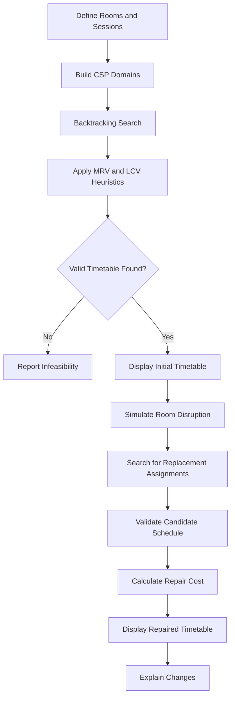

# CampusFlow AI

### Conflict-Aware Classroom Scheduling with Intelligent Recovery

**CampusFlow AI** is a Python-based scheduling system that generates valid classroom and laboratory timetables and intelligently repairs them when resources become unavailable.

Its primary objective is not simply to produce a valid timetable. It is to **recover from scheduling disruptions while minimizing unnecessary changes to existing assignments**.

The project demonstrates classical Artificial Intelligence techniques, including Constraint Satisfaction Problems (CSPs), backtracking search, Minimum Remaining Values (MRV), Least Constraining Value (LCV), constraint validation, and cost-based schedule repair.

> **Project type:** AI Mini-Project  
> **Status:** Educational prototype  
> **Interface:** Streamlit  
> **Language:** Python  
> **Primary focus:** Constraint satisfaction and minimum-change rescheduling

---

## Table of Contents

- [Overview](#overview)
- [Problem Statement](#problem-statement)
- [Key Features](#key-features)
- [How It Works](#how-it-works)
- [AI Algorithms](#ai-algorithms)
- [Technology Stack](#technology-stack)
- [Getting Started](#getting-started)
- [Running the Application](#running-the-application)
- [Running the Tests](#running-the-tests)
- [Demonstration Workflow](#demonstration-workflow)
- [Project Structure](#project-structure)
- [Architecture and Design Decisions](#architecture-and-design-decisions)
- [Limitations](#limitations)
- [Roadmap](#roadmap)
- [Contributing](#contributing)
- [License](#license)

---

## Overview

Educational institutions share classrooms, laboratories, and other resources across multiple classes and practical sessions.

Creating a timetable becomes challenging when rooms have different capacities, sessions require specific equipment, and resources are available only during particular time slots.

The problem becomes more complicated when an already-assigned room suddenly becomes unavailable.

CampusFlow AI addresses this problem through constraint-based scheduling and disruption-aware rescheduling.

Instead of rebuilding the entire timetable without considering existing assignments, the system searches for a feasible repair and attempts to preserve unaffected sessions.

### Project Objectives

- Generate timetables that satisfy defined scheduling constraints.
- Prevent classroom and laboratory double-booking.
- Respect room capacity, availability, and facility requirements.
- Model scheduling as a Constraint Satisfaction Problem.
- Apply backtracking and search heuristics to find valid assignments.
- Recover from room unavailability.
- Minimize unnecessary changes during rescheduling.
- Validate the resulting timetable before presenting it as successful.
- Explain the changes made during the repair process.

---

## Problem Statement

Consider a college timetable containing lectures and laboratory sessions.

Each session requires a suitable room and a permitted time slot. A room must have enough capacity, provide the required facilities, and remain available throughout the session.

Suppose a laboratory becomes unavailable after the timetable has been generated.

A naive approach might require staff to manually rearrange several sessions. An automated approach should identify the affected assignments, search for alternatives, and preserve the rest of the timetable whenever possible.

CampusFlow AI models this as a constraint satisfaction and optimization problem.

### Example Scenario

1. A practical session is assigned to Lab A at 10:00 AM.
2. Lab A becomes unavailable.
3. The system identifies the affected assignment.
4. It searches for alternative room and time combinations.
5. If necessary, it considers moving other sessions to make room.
6. It validates the resulting schedule.
7. It compares the original and repaired timetables and reports the changes.

If no feasible solution exists under the configured constraints, the system should report that outcome instead of silently presenting an invalid timetable as successful.

---

## Key Features

| Feature | Description |
|---|---|
| CSP-based scheduling | Represents sessions as variables and room/time assignments as domains |
| Backtracking search | Explores assignments and reverses choices when they lead to conflicts |
| MRV heuristic | Prioritizes the session with the fewest remaining valid assignments |
| LCV heuristic | Prefers assignments that preserve options for other sessions |
| Capacity validation | Prevents assigning sessions to undersized rooms |
| Facility validation | Checks whether rooms satisfy session requirements |
| Availability validation | Checks room availability throughout the occupied duration |
| Conflict detection | Detects overlapping room and session assignments |
| Disruption simulation | Models a room becoming unavailable |
| Automatic timetable repair | Searches for a feasible replacement schedule |
| Repair-cost optimization | Penalizes unnecessary assignment changes |
| Result explanation | Presents changes between the original and repaired schedules |
| Interactive interface | Provides a Streamlit application for working with the scheduler |
| CSV export | Allows timetable results to be exported |
| Automated tests | Tests the scheduling engine, constraints, and rescheduling behavior |

---

## How It Works

The system follows a structured scheduling workflow.



### 1. Input

The application uses room and session information to construct a scheduling problem.

Room information includes capacity, facilities, and availability.

Session information includes student count, duration, required facilities, permitted start slots, and priority.

### 2. Constraint Modelling

The scheduler represents each session as a variable.

Its domain contains possible room and time assignments.

Hard constraints determine which assignments are allowed.

### 3. Initial Scheduling

The backtracking engine searches for assignments that satisfy the constraints.

MRV helps choose the next session, while LCV helps order candidate assignments.

### 4. Disruption Handling

When a room becomes unavailable, the system updates the scheduling problem and searches for a replacement allocation.

### 5. Repair Optimization

The system evaluates feasible repairs according to their change cost.

It attempts to minimize unnecessary changes while ensuring that hard constraints remain satisfied.

### 6. Validation and Explanation

The resulting timetable is validated and compared with the original schedule.

The interface presents the outcome and the changes made during rescheduling.

---

## AI Algorithms

### Constraint Satisfaction Problem (CSP)

A CSP consists of variables, domains, and constraints.

In CampusFlow AI:

- **Variables:** Sessions that need to be scheduled.
- **Domains:** Feasible room and start-time combinations.
- **Constraints:** Rules that determine whether assignments are valid.

For example, if a session requires 40 seats, a room with a capacity of 25 cannot be included in its feasible domain.

### Backtracking Search

Backtracking assigns values to variables one at a time.

If an assignment causes a conflict or leaves the remaining problem without a feasible continuation, the algorithm reverses that assignment and explores another choice.

This approach systematically searches for valid schedules instead of relying on random assignment.

### Minimum Remaining Values (MRV)

MRV selects the unassigned variable with the smallest remaining domain.

In this project, a session with very few feasible room/time combinations is generally considered before a more flexible session.

This reduces the chance of leaving difficult-to-schedule sessions until the end.

### Least Constraining Value (LCV)

LCV prioritizes assignments that eliminate the fewest options for other unassigned sessions.

The objective is to preserve flexibility and reduce unnecessary backtracking.

### Minimum-Change Rescheduling

A timetable can be valid without being a good repair.

For example, moving ten sessions to accommodate one unavailable room may be unnecessary if a valid solution exists that moves only one or two.

CampusFlow AI uses a repair-cost objective to prefer lower-impact changes.

Hard constraints remain mandatory: a lower repair cost cannot justify an invalid timetable.

> The project uses classical AI search and constraint reasoning. It does not require a trained machine-learning model or an external AI API.

---

## Technology Stack

| Technology | Purpose |
|---|---|
| Python 3.10+ | Scheduling logic, domain models, constraint checks, and repair |
| Streamlit | Interactive web interface |
| Pandas | Tabular data handling and timetable export |
| Pytest | Automated testing |
| JSON | Sample data and local persistence |
| Git and GitHub | Version control and collaboration |
| GitHub Actions | Automated test execution in CI |

---

## Getting Started

Follow these instructions to run CampusFlow AI locally.

### Prerequisites

Install the following:

- Python 3.10 or newer
- `pip`
- Git, if cloning the repository

Check your Python installation:

```bash
python --version
```

Check pip:

```bash
python -m pip --version
```

### 1. Clone the Repository

Replace `<your-github-username>` with the GitHub account hosting the repository.

```bash
git clone https://github.com/<your-github-username>/CampusFlow-AI.git
```

Move into the project directory:

```bash
cd CampusFlow-AI
```

Alternatively, download the repository as a ZIP and extract it.

### 2. Create a Virtual Environment

A virtual environment isolates project dependencies from other Python applications.

#### Windows — PowerShell

```powershell
py -3.10 -m venv .venv
```

Activate it:

```powershell
.\.venv\Scripts\Activate.ps1
```

If Python 3.10 is unavailable through the Python launcher, use an installed supported version:

```powershell
python -m venv .venv
.\.venv\Scripts\Activate.ps1
```

If PowerShell blocks virtual-environment activation, allow it for the current terminal session:

```powershell
Set-ExecutionPolicy -Scope Process -ExecutionPolicy Bypass
.\.venv\Scripts\Activate.ps1
```

#### macOS and Linux

```bash
python3 -m venv .venv
source .venv/bin/activate
```

### 3. Install Dependencies

Run the following commands from the project root:

```bash
python -m pip install --upgrade pip
python -m pip install -r requirements.txt
```

This installs the dependencies listed in `requirements.txt`.

### 4. Launch the Application

Start the Streamlit application:

```bash
python -m streamlit run app.py
```

Streamlit will display a local URL in the terminal. Open that address in your browser.

The default local address is typically:

```text
http://localhost:8501
```

Keep the terminal open while using the application.

To stop the application, press `Ctrl+C` in the terminal.

---

## Running the Tests

Automated tests help verify that scheduling behavior remains correct as the project evolves.

Install the project dependencies first, then run the following command from the repository root:

```bash
python -m pytest -q
```

For more detailed output:

```bash
python -m pytest -v
```

Run individual test modules when investigating a specific area:

```bash
python -m pytest tests/test_constraints.py -v
```

```bash
python -m pytest tests/test_scheduler.py -v
```

```bash
python -m pytest tests/test_rescheduler.py -v
```

### Continuous Integration

The repository includes a GitHub Actions workflow under `.github/workflows/`.

When configured in the repository, the workflow runs automated tests on pushes and pull requests.

Check the **Actions** tab on GitHub to inspect workflow results.

---

## Demonstration Workflow

For a practical examination or project demonstration, follow this sequence.

1. Start the application.
2. Load the sample room and session data.
3. Generate an initial timetable.
4. Review the assignments and validation status.
5. Simulate a room becoming unavailable.
6. Run the rescheduling process.
7. Compare the original and repaired timetables.
8. Identify which sessions moved and inspect their new assignments.
9. Review the repair cost and validation results.
10. Export the timetable as CSV if required.

This demonstration highlights the main contribution of the project: disruption recovery with a preference for minimal changes.

For a more detailed walkthrough, see [`docs/DEMO_SCRIPT.md`](docs/DEMO_SCRIPT.md).

---

## Project Structure

```text
CampusFlow-AI/
│
├── app.py
├── requirements.txt
├── README.md
├── LICENSE
├── CHANGELOG.md
├── CONTRIBUTING.md
├── .gitignore
├── .editorconfig
│
├── campusflow/
│   ├── __init__.py
│   ├── models.py
│   ├── constraints.py
│   ├── scheduler.py
│   ├── optimizer.py
│   ├── rescheduler.py
│   ├── sample_data.py
│   └── storage.py
│
├── data/
│   └── sample_data.json
│
├── docs/
│   ├── ARCHITECTURE.md
│   └── DEMO_SCRIPT.md
│
├── tests/
│   ├── conftest.py
│   ├── test_constraints.py
│   ├── test_scheduler.py
│   └── test_rescheduler.py
│
└── .github/
    └── workflows/
        └── tests.yml
```

### Module Responsibilities

| Module | Responsibility |
|---|---|
| `app.py` | Streamlit interface and application workflow |
| `models.py` | Room, session, and assignment data models |
| `constraints.py` | Hard-constraint validation |
| `scheduler.py` | CSP domains, backtracking, and search heuristics |
| `optimizer.py` | Assignment-change cost calculation |
| `rescheduler.py` | Disruption handling and timetable repair |
| `sample_data.py` | Sample dataset loading |
| `storage.py` | Local JSON persistence |
| `tests/` | Automated tests for core behavior |
| `docs/` | Architecture and demonstration documentation |

---

## Architecture and Design Decisions

### Separation of Concerns

The scheduling engine is separated from the Streamlit interface.

This allows the core scheduling logic to be tested independently of the UI and makes future interface changes easier.

### Hard Constraints vs. Soft Objectives

Hard constraints determine whether a timetable is valid.

Examples include:

- Room capacity must be sufficient.
- Required facilities must be available.
- The room must be available throughout the session.
- A room cannot host overlapping sessions.
- A session cannot be assigned conflicting time ranges.

Soft objectives guide the choice among valid timetables.

Examples include:

- Minimize the number of moved sessions.
- Preserve existing assignments where possible.
- Reduce disruption to high-priority sessions.

The system must not trade hard-constraint validity for a lower repair cost.

### Honest Failure Handling

A scheduler should not claim success merely because it has produced a list of assignments.

The resulting timetable must satisfy the hard constraints.

If the problem is infeasible or a search limit prevents finding a solution, the application should communicate the outcome clearly.

### Search Complexity

Backtracking can have exponential worst-case complexity.

MRV and LCV help guide the search, but they do not eliminate the underlying worst-case difficulty.

The project therefore focuses on small, reproducible scheduling scenarios and understandable behavior rather than claiming to solve institution-scale scheduling optimally.

For more detail, see [`docs/ARCHITECTURE.md`](docs/ARCHITECTURE.md).

---

## Limitations

CampusFlow AI is an educational prototype rather than a production-ready university scheduling platform.

Current limitations include:

- Scheduling uses discrete teaching slots.
- Each session is assigned to one room for its full duration.
- Backtracking may become expensive for larger scheduling problems.
- A search limit may prevent the system from finding a solution even when one exists.
- Finding a feasible repair does not necessarily prove that it is globally optimal.
- Local JSON persistence is intended for a small, single-user demonstration.
- Authentication, concurrent editing, and production deployment hardening are outside the current scope.

These limitations provide opportunities for further development and evaluation.

---

## Roadmap

Potential future improvements include:

- Add property-based and edge-case tests for scheduling invariants.
- Create benchmark datasets to evaluate search performance.
- Measure the impact of MRV and LCV on search effort.
- Improve accessibility and add focused UI integration tests.
- Introduce optional SQLite persistence.
- Evaluate stronger constraint propagation techniques.
- Explore dedicated optimization solvers for larger scheduling instances.

Future improvements should be driven by measurable requirements rather than unnecessary complexity.

---

## Contributing

Contributions, bug reports, and suggestions are welcome.

Before submitting a change:

1. Create a focused branch.
2. Keep scheduling logic within the `campusflow/` package.
3. Add or update tests for changed behavior.
4. Run the test suite.
5. Verify that the application starts locally.
6. Document changes to hard constraints or repair-cost behavior.

See [`CONTRIBUTING.md`](CONTRIBUTING.md) for the development workflow.

---

## License

This project is distributed under the terms specified in [`LICENSE`](LICENSE).